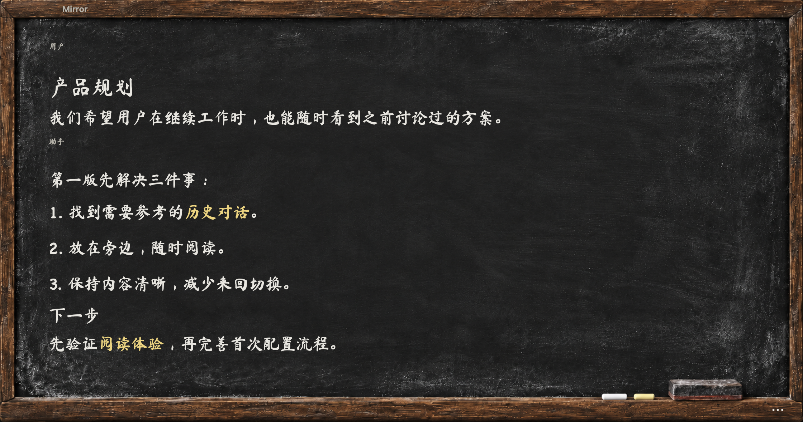

# Mirror

**把历史对话留在旁边，继续手头的工作。**

Mirror 是一款原生 macOS 只读参考工具。它把已有的本机 Codex 对话放进独立黑板窗口，让需求、解释和检查清单各有一个位置。Agent 可以帮你打开、查找和安排窗口；你随时可以直接操作。



## 下载与开始使用

- [完整包：桌面端＋技能＋函数工具](https://github.com/ChanghaoLiao/Mirror/releases/download/v1.0.0-preview.1/Mirror-Complete-1.0.0-preview.1-macos-arm64.zip)：解压后把整个文件夹交给本机 Agent，按README操作；也可把Mirror.app拖到应用程序后打开。
- [轻量 Skill 包](https://github.com/ChanghaoLiao/Mirror/releases/download/v1.0.0-preview.1/Mirror-Agent-Toolkit-1.0.0.zip)：把解压目录交给本机 Agent，它会在缺少桌面端时从同一 GitHub Release 下载固定版本并校验。
- [校验值](https://github.com/ChanghaoLiao/Mirror/releases/download/v1.0.0-preview.1/SHA256SUMS.txt) · [完整发布说明](https://github.com/ChanghaoLiao/Mirror/releases/tag/v1.0.0-preview.1)

**平台：Apple Silicon、macOS 14+。这是1.0.0-preview.1测试发行，桌面端为1.0.0 build10，ad-hoc签名，未通过Apple公证。** 首次打开的macOS确认与辅助功能授权必须由你亲手完成。[安装与权限](docs/installation.md)。不需要自己编译、配置模型Key或购买Mirror的Token。

可以把这句话发给Agent：

> 请读取这个Mirror文件夹里的README和skills/mirror-setup/SKILL.md，帮我安装并检查Mirror；保留我的操作优先权，系统首次打开与权限由我亲手确认。准备好后，把我指定的Codex历史留在旁边。

## 它能做什么

- 多个独立参考窗，分别保留阅读位置、字号和窗口尺寸。
- 选择已有对话、正文查找、选择复制文字、复制当前消息。
- 保留旧内容的后台刷新；成功后更新，失败仍可继续阅读。
- 老式木框黑板与粉笔字；斜向板擦开场可跳过，遵循减少动态效果。
- 授权后绑定Codex宿主窗口；人工改动和暂停始终优先于旧Agent命令。

Mirror 不发消息、不生成回答、不分叉Agent任务，也不改写原对话。它当前只读取本机Codex历史，不会实时镜像正在生成的每个字。

## 本地 Agent 工具

技能与15个严格Function Calling函数共用原生接口。打开、查找、刷新、排布窗口由本地代码完成，不在Mirror里调用大模型。宿主Agent理解意图、加载技能和读取回执仍可能消耗Token，“零Token”不代表整个流程免费。

控制方可以是有Mac本机执行能力的Agent；数据源仍是Codex。普通云端ChatGPT没有本机执行器时不能直接控制Mac。其他宿主的安装/发现方式由该宿主管理，不承诺所有平台已认证。

[技能入口](plugins/mirror/skills/mirror/SKILL.md) · [首次设置](plugins/mirror/skills/mirror-setup/SKILL.md) · [函数协议](plugins/mirror/skills/mirror/references/function-calling.md) · [函数schema](plugins/mirror/skills/mirror/references/function-tools.json)

## 隐私与测试

无Mirror云端服务、无模型Key、无遥测上传。对话正文仅在内存中；窗口和阅读位置元数据保存在本机。默认不读取远程图片或任意附件路径。[隐私说明](docs/privacy.md)。演示截图不含私人对话。

安装器校验固定SHA256、应用标识、版本、构建号与 sealed CDHash。测试版保留或添加quarantine，不移除系统保护；正式安装器的Developer ID与公证要求保持独立。未在第二台干净Mac完整验证首次人工授权，不把模拟测试说成真实Gatekeeper验收。[验证范围](docs/validation.md)。

## 开发

从源码构建需要完整Xcode及Swift6；普通下载用户不需要这些工具。

```sh
bash scripts/swift.sh test -Xswiftc -warnings-as-errors
bash tests-plugin/run.sh
python3 scripts/package-agent.py
bash scripts/build.sh
```

[贡献](CONTRIBUTING.md) · [问题反馈](https://github.com/ChanghaoLiao/Mirror/issues) · [MIT许可](LICENSE)

由Changhao Liao维护。独立项目，与OpenAI无官方隶属或背书关系。
